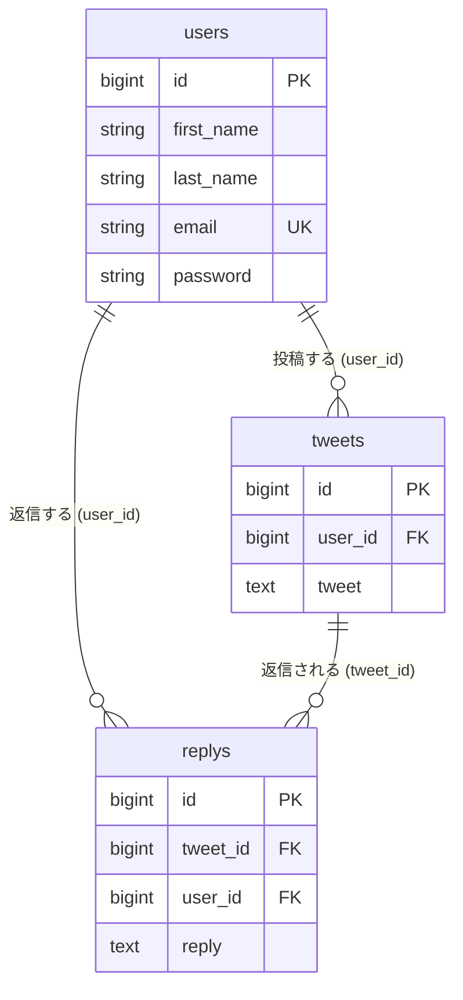

# my-laravel-app-breeze

Laravel 12 + Laravel Breeze で作った、Twitter ライクな **ツイート投稿・返信アプリ** です。
素の PHP で作成した掲示板アプリを、Laravel の作法（ルーティング / Eloquent / Blade / 認証）に置き換えながら学習した成果物です。

> [!NOTE]
> 学習目的のアプリケーションです。実運用を想定した実装にはなっていません（[既知の課題](#既知の課題--今後の対応) 参照）。

## 主な機能

| 機能 | 画面 / エンドポイント | 担当 |
| --- | --- | --- |
| 画面一覧（TOP） | `GET /` | `resources/views/index.blade.php` |
| ユーザー登録 | `GET,POST /register` | Breeze `RegisteredUserController` |
| ログイン / ログアウト | `GET,POST /login` / `POST /logout` | Breeze `AuthenticatedSessionController` |
| ツイート一覧（ダッシュボード） | `GET /dashboard` | `TweetController@index` |
| ツイート投稿 | `GET /tweets/create` → `POST /tweets` | `TweetController@create,store` |
| ツイート詳細（返信一覧） | `GET /tweets/{tweet}` | `TweetController@show` |
| 返信投稿 | `GET /replys/create/{tweet}` → `POST /replys/{tweet}` | `ReplyController@create,store` |
| ユーザー一覧 | `GET /users` | `UserController@index` |
| プロフィール編集 / 削除 | `GET,PATCH,DELETE /profile` | Breeze `ProfileController` |
| パスワード変更 | `PUT /password` | Breeze `PasswordController` |

`/dashboard` 以降の画面は `auth` / `verified` ミドルウェアで保護しています。

> [!IMPORTANT]
> ユーザー登録の経路が2系統あります。動作するのは Breeze の **`/register`** です。
> TOP ページの「ユーザー追加画面」ボタンが指している `UserController` 側（`/users/create` → `/users/store`）は未修正で、登録が完了しません（[既知の課題](#usercontroller独自のユーザー登録--ログイン) 参照）。

## 技術スタック


- **バックエンド**: PHP 8.2 / Laravel 12 / Laravel Breeze（Blade + Alpine.js スタック）
- **フロントエンド**: Blade / Tailwind CSS / Alpine.js / Vite
- **データベース**: MySQL（XAMPP + phpMyAdmin）
- **開発環境**: XAMPP（Windows）、`php artisan serve`
- **テスト**: PHPUnit 11（Breeze 付属の認証系 Feature テスト）

## ER 図



- ユーザー名は `name` ではなく **`first_name` / `last_name`** の 2 カラム構成です。
- 返信テーブルは **`replys`**（Laravel 規約の `replies` ではない）ため、`Reply` モデルで `protected $table = 'replys';` を明示しています。
- 3 テーブルとも `timestamps` を持たないため、各モデルで `public $timestamps = false;` を指定しています。
- マイグレーションはこの 3 テーブルのみです。Laravel 標準の `password_reset_tokens` / `sessions` / `cache` / `jobs` は作成していません。

画面遷移図・シーケンス図は [mermaid/](mermaid/) にまとめています。

- [mermaid/flowchart.md](mermaid/flowchart.md) — 画面遷移フロー
- [mermaid/sequenceDiagram.md](mermaid/sequenceDiagram.md) — 新規登録 / ログイン / パスワード変更 / ログアウトのシーケンス
- [mermaid/erDiagram.md](mermaid/erDiagram.md) — ER 図

## セットアップ

### 前提

- PHP 8.2 以上
- Composer
- Node.js 18 以上 / npm
- MySQL（XAMPP 同梱のもので可）

### 1. 取得と依存パッケージのインストール

```bash
git clone https://github.com/<your-account>/my-laravel-app-breeze.git
cd my-laravel-app-breeze
composer install
npm install
```

### 2. 環境設定ファイルの作成

```bash
cp .env.example .env
php artisan key:generate
```

### 3. `.env` の編集

`.env.example` は SQLite・DB セッション前提のため、以下を書き換えます。
セッション / キャッシュ用のテーブルを作っていないので、どちらも `file` ドライバを使用します。

```diff
- DB_CONNECTION=sqlite
- # DB_HOST=127.0.0.1
- # DB_PORT=3306
- # DB_DATABASE=laravel
- # DB_USERNAME=root
- # DB_PASSWORD=
+ DB_CONNECTION=mysql
+ DB_HOST=127.0.0.1
+ DB_PORT=3306
+ DB_DATABASE=twitter
+ DB_USERNAME=root
+ DB_PASSWORD=

- SESSION_DRIVER=database
+ SESSION_DRIVER=file

- CACHE_STORE=database
+ CACHE_STORE=file

- APP_LOCALE=en
+ APP_LOCALE=ja
```

> `DB_USERNAME=root` / `DB_PASSWORD=`（空）は XAMPP の初期設定です。

### 4. テーブル作成と初期データ投入

phpMyAdmin などで **`twitter`** という名前のデータベースを作成してから、マイグレーションとシーディングを実行します。

```bash
php artisan migrate --seed
```

初期データとしてユーザー10名・ツイート10件・リプライ10件が登録されます。パスワードは全員 `password123` です。

[DatabaseSeeder](database/seeders/DatabaseSeeder.php) は、`Hash::make('password123')` で bcrypt ハッシュを1回だけ作って `INSERT` 文に埋め込み、ツイートとリプライは `database/sql/twitter_database_inserts.sql` を `DB::unprepared()` で実行して投入します。素の PHP 版で使っていた SQL をそのまま活かした構成です。

> [!IMPORTANT]
> 読み込む SQL の先頭に `USE twitter;` が書かれているため、**データベース名は `twitter` である必要があります**。
> またシーダーは同じデータを重ねて投入するので、やり直すときは `php artisan db:seed` ではなく `php artisan migrate:fresh --seed` を使ってください。

### 5. 起動

```bash
npm run dev        # 別ターミナルで Vite を起動
php artisan serve  # http://localhost:8000
```

`composer dev` を使うと、開発サーバー / キューワーカー / ログ（Pail）/ Vite をまとめて起動できます。

```bash
composer dev
```

ブラウザで <http://localhost:8000> を開くと「画面一覧」が表示されます。
初期データを投入済みであれば、「ログイン画面」から以下でログインできます。

```
メールアドレス: john@john.com
パスワード:     password123
```

新しくユーザーを作る場合は <http://localhost:8000/register> を直接開いてください。

## テスト

```bash
composer test
# または
php artisan test
```

テストは `:memory:` の SQLite で実行されるため、開発用の MySQL には影響しません。

> [!WARNING]
> 現状 **20 件が失敗 / 5 件が成功** します。同梱のテストは Breeze 標準のもので、`UserFactory` が `name` カラム前提のままのため、`table users has no column named name` で落ちます。詳細は [既知の課題](#テスト--整理) を参照してください。

## ディレクトリ構成（主要部分）

```
app/
├── Http/Controllers/
│   ├── Auth/                 # Breeze の認証コントローラー群
│   ├── ProfileController.php # プロフィール編集（Breeze）
│   ├── TweetController.php   # ツイート一覧 / 投稿 / 詳細
│   ├── ReplyController.php   # 返信の表示 / 投稿
│   └── UserController.php    # ユーザー一覧 / 登録（※課題参照）
└── Models/
    ├── User.php
    ├── Tweet.php
    └── Reply.php
database/
├── factories/
│   ├── UserFactory.php       # ※スキーマ未対応、課題参照
│   └── UserFactoryTest.php   # ※命名規約から外れており未使用
├── migrations/               # users / tweets / replys
├── seeders/
│   ├── DatabaseSeeder.php    # 初期データ投入（生SQL + Hash::make）
│   └── sample.php            # ※未使用、課題参照
└── sql/                      # 素の PHP 版から引き継いだ SQL
mermaid/                      # ER 図・画面遷移図・シーケンス図
resources/views/
├── index.blade.php           # TOP（画面一覧）
├── dashboard.blade.php       # ツイート一覧
├── tweet/                    # create / show
├── reply/                    # create
├── users/                    # index / create / update
└── auth/, profile/, layouts/, components/   # Breeze 由来
routes/
├── web.php                   # 実際に使用しているルート定義
├── auth.php                  # Breeze の認証ルート
└── sampleweb.php             # 学習初期のルート（未読み込み）
```

## 実装のポイント

素の PHP 版から書き換える際に、フレームワークの機能に置き換えた部分です。

- **Route Model Binding** — `GET /tweets/{tweet}` や `POST /replys/{tweet}` で `Tweet` インスタンスを直接受け取り、コントローラー内の `findOrFail()` を省いています。
- **Eager Loading** — ツイート一覧は `Tweet::with('user')->get()` で投稿者を併せて取得し、N+1 クエリを回避しています。
- **リレーション** — `Tweet` / `Reply` から `belongsTo(User::class)` で投稿者名を解決しています。
- **ミドルウェアによる保護** — ログイン後の画面は `Route::middleware(['auth', 'verified'])->group()` でまとめて保護しています。
- **バリデーション** — `$request->validate()` の戻り値を `$validated` で受け取り、検証済みの値だけを `User::create()` に渡しています。投稿フォームはエラー時に `old()` で入力値を復元します。
- **パスワードのハッシュ化** — `User` モデルの `'password' => 'hashed'` キャストにより、代入した平文が自動的に bcrypt になります。素の PHP 版で自分で書いていた `hash('sha256', ...)` が不要になった部分です。bcrypt はハッシュごとにソルトが異なるため、`WHERE password = ?` では照合できず `Hash::check()` / `Auth::attempt()` を使います。
- **クロージャへの変数の受け渡し** — `NewPasswordController` では `Password::reset()` に渡すクロージャの中で検証済みの値を使うため、`use ($validated)` で明示的に渡しています。
- **bcrypt のコスト対策** — bcrypt は1件あたり約 0.24 秒かかるため、シーダーでは `Hash::make()` の結果を一度だけ作って10件で使い回しています。

## 既知の課題 / 今後の対応

学習過程の成果物のため、以下が未解決のまま残っています。

### UserController（独自のユーザー登録 / ログイン）

Breeze の認証コントローラー（登録 / ログイン / パスワード変更 / パスワードリセット）は bcrypt に統一済みです。残っているのは `UserController` 側です。

- [ ] **`UserController@store` でパスワードが保存されない** — `$request->paasword`（`password` の綴り誤り。かつフォームの項目名は `psw`）を参照しているため `null` が入り、`users.password` の NOT NULL 制約違反になります。正しくは `$request->psw` です。
- [ ] **TOP ページのボタンが壊れている側を指している** — `index.blade.php` の「ユーザー追加画面」が `users.create` に向いているため、上記の理由で登録が完了しません。動作する `/register` に向けるか、`UserController@store` を修正する必要があります。
- [ ] **`UserController@authenticate` のパスワード照合が無効** — `->where('password', ...)` がコメントアウトされており、メールアドレスだけで認証が通る状態です。bcrypt はソルトが毎回異なるため等価比較では照合できず、`Hash::check()` または `Auth::attempt()` への置き換えが必要です。なおこのメソッドへのルートは未読み込みの `routes/sampleweb.php` 側にしかなく、現在は到達不可です。

### 認証機能の未整備

- [ ] **パスワードリセットが使えない** — `password_reset_tokens` テーブルのマイグレーションがないため、`/forgot-password` はエラーになります。
- [ ] **`remember_token` / `email_verified_at` カラムが未作成** — ログイン時の「ログイン状態を保持する」やメール認証は機能しません。`NewPasswordController` の `remember_token` 更新はこのためコメントアウトしています。
- [ ] **`register.blade.php` に未使用の `name` 入力が残っている** — サーバー側は `first_name` / `last_name` のみ検証するため値は無視されますが、画面上は氏名の入力欄が3つ並びます。

### テスト / 整理

- [ ] **`UserFactory` がスキーマと不整合（テスト20件が失敗）** — `name` / `email_verified_at` / `remember_token` を前提にしているため、存在しないカラムへの `INSERT` で落ちます。`first_name` / `last_name` 構成に直す必要があります。
- [ ] **`UserFactoryTest` が使用されない** — スキーマには沿っていますが、`User::factory()` が探すのは `UserFactory` という命名規約のため読み込まれません。また `fake()->first_name()` は存在しないフォーマッタで、正しくは `fake()->firstName()` です。
- [ ] **シーダーが生 SQL に依存している** — データベース名が `twitter` 固定（SQL 内の `USE twitter;`）で、再実行すると重複します。Eloquent ベースのシーダーに分割すれば解消できます。
- [ ] **`routes/sampleweb.php` が未使用** — `bootstrap/app.php` から読み込まれていない学習初期のルート定義です。整理対象。
- [ ] **`database/seeders/sample.php` が不要** — ファイル名とクラス名（`DatabaseSeeder`）が一致しておらずオートロードされません。参照している `ItemTableSeeder` も存在しません。
- [ ] **`database/database.sqlite` が残存** — MySQL に移行済みのため不要。
- [ ] Blade 内に残っている学習メモ・コメントアウトの整理。

## ライセンス

[MIT License](https://opensource.org/licenses/MIT)
