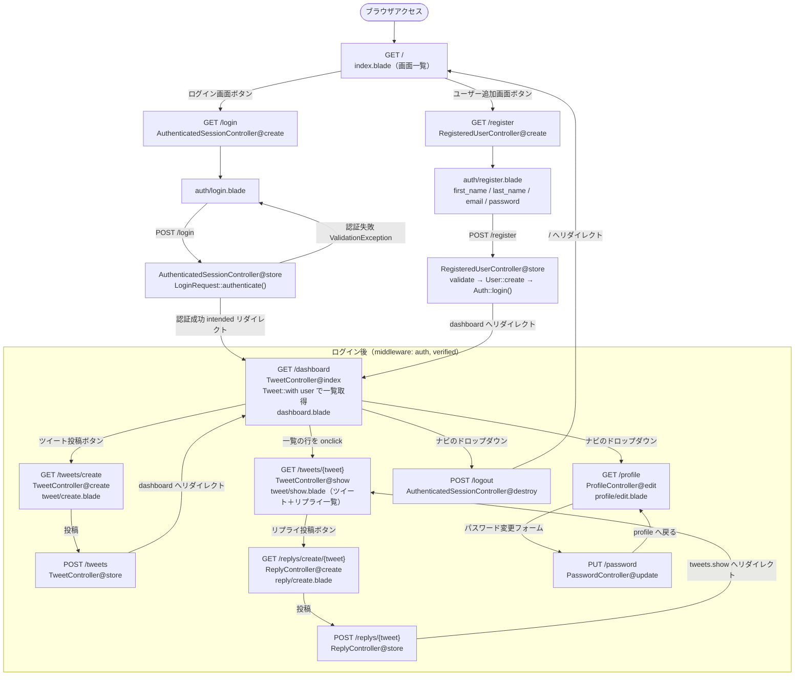

# 画面遷移フロー

`routes/web.php` / `routes/auth.php` に定義されている、実際に読み込まれているルートのみを記載しています。
（`routes/sampleweb.php` は `bootstrap/app.php` から読み込まれていないため対象外）

## 補足

- ユーザー登録は Breeze の `/register` に一本化しています。TOP ページの「ユーザー追加画面」ボタンから遷移します（独自の `UserController` は削除済み）。
- `/dashboard` が `TweetController@index`（ツイート一覧）を兼ねています。
- `verified` ミドルウェアは付与していますが、`User` モデルが `MustVerifyEmail` を実装していないため実質的に素通りします。
- パスワードリセット（`/forgot-password` → `/reset-password/{token}`）は `password_reset_tokens` テーブルがないため動作せず、この図からは省いています。
