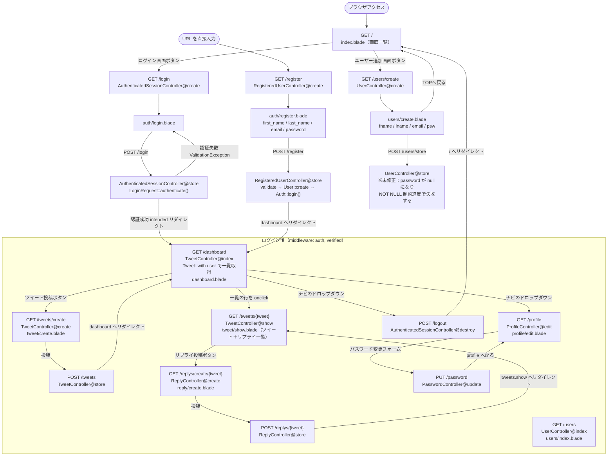

# 画面遷移フロー

`routes/web.php` / `routes/auth.php` に定義されている、実際に読み込まれているルートのみを記載しています。
（`routes/sampleweb.php` は `bootstrap/app.php` から読み込まれていないため対象外）

## 補足

- **ユーザー登録の経路は2系統あります。** 動作するのは Breeze の `/register` です。TOP ページの「ユーザー追加画面」ボタンは `UserController` 側（`/users/create` → `/users/store`）に向いていますが、`UserController@store` が未修正のため登録が完了しません。
- `/register` はどの画面からもリンクされていないため、URL を直接開く必要があります（`samplewelcome.blade.php` にリンクがありますが、このビューはルーティングされていません）。
- `/dashboard` が `TweetController@index`（ツイート一覧）を兼ねています。
- `verified` ミドルウェアは付与していますが、`User` モデルが `MustVerifyEmail` を実装していないため実質的に素通りします。
- `GET /users`（ユーザー一覧）はルートとしては存在しますが、どの画面からもリンクされていません。
- パスワードリセット（`/forgot-password` → `/reset-password/{token}`）は `password_reset_tokens` テーブルがないため動作せず、この図からは省いています。
