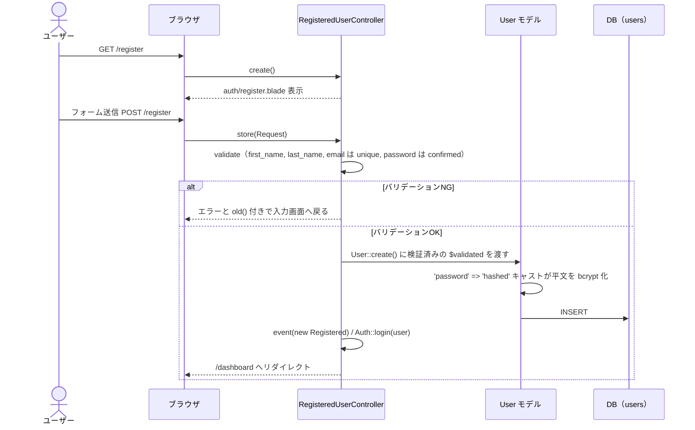
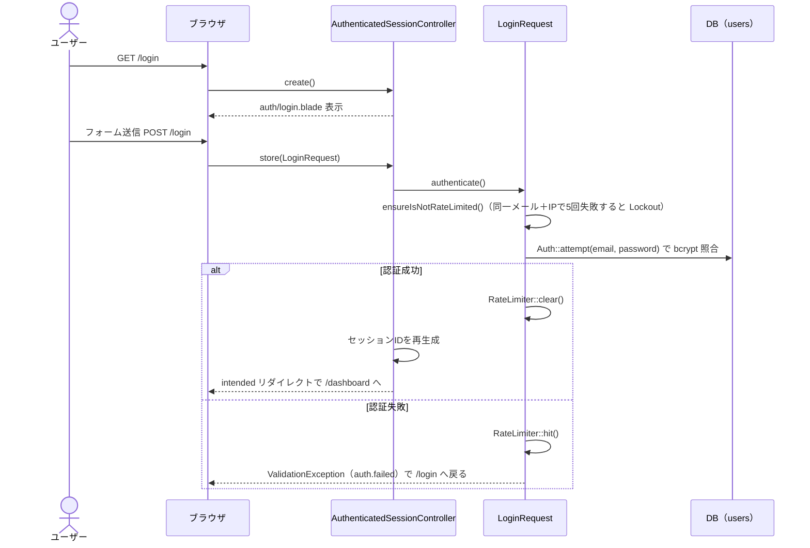
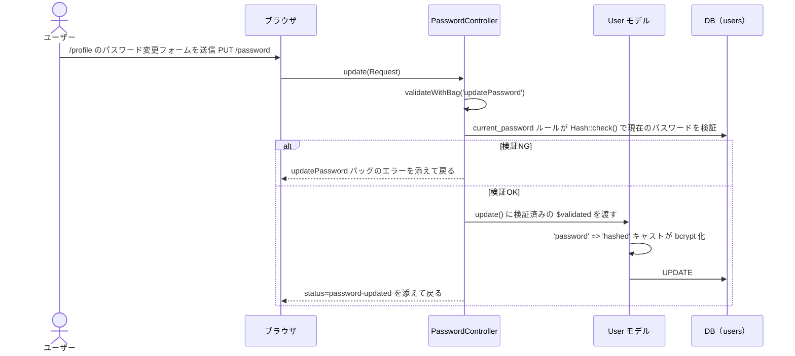
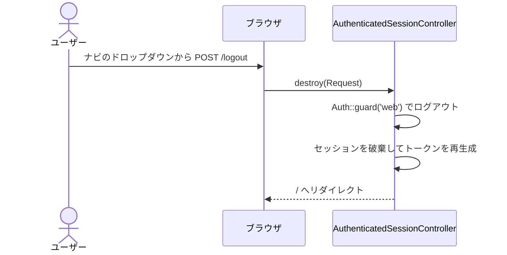

# シーケンス図

## 新規ユーザー登録

Breeze の `/register` 経由の登録フローです（動作する経路）。

`UserController@store`（`/users/store`）にも登録処理がありますが、パスワードの参照先が誤っていて未修正のため、こちらは図に含めていません。

## ログイン

bcrypt はハッシュごとにソルトが異なるため、`WHERE password = ?` のような等価比較では照合できません。
`Auth::attempt()` が内部で `Hash::check()` を呼び、ハッシュに埋め込まれたソルトを使って突き合わせます。

## パスワード変更

## ログアウト

